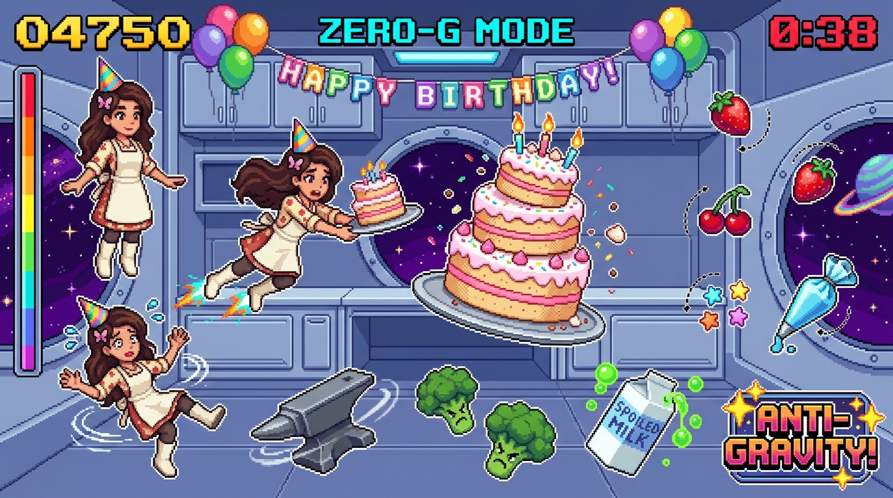

# 🎂 Anti-Gravity Birthday Bake-Off (2D Pixel-Art Game) 🚀

A retro 16-bit arcade catcher game built with Python and Pygame (`pygame-ce`), inspired by zero-gravity space baking adventures.



---

## 🎮 Gameplay Overview

You play as a baker floating inside a spaceship kitchen cockpit. Cake tiers, candles, strawberries, cherries, candies, and frosting bags drift down from zero-G orbit—catch them on your raised tray to assemble the ultimate birthday cake!

Watch out for dangerous tumbling hazards:
- 🪨 **Spinning Heavy Anvils**
- 🥦 **Angry Broccoli Asteroids**
- 🥛 **Bubbling Spoiled Milk Cartons**

Get hit by an obstacle and you'll lose one of your 3 lives! Survive all 10 stages with increasing speed and chaos to win the bake-off championship.

---

## 🕹️ Controls

| Key | Action |
|---|---|
| <kbd>A</kbd> / <kbd>D</kbd> or <kbd>←</kbd> / <kbd>→</kbd> | Move Left / Right |
| <kbd>SPACE</kbd> | Start Game / Confirm / Play Again |
| <kbd>ESC</kbd> | Pause / Resume Game |
| <kbd>Q</kbd> *(while paused)* | Quit to Main Menu |

---

## ✨ Features

- **Pixel-Art Aesthetic:** Pixel baker with long wavy hair, pink butterfly clip, party hat, apron, and sneakers.
- **Dynamic Cockpit Environment:** 3-layer parallax starfield, portholes looking out into space galaxies, drifting balloons, and celebratory `"HAPPY BIRTHDAY!"` bunting.
- **Particle Systems:** Confetti rain, score popups (`+150`, `+200`), collect bursts, hit alerts (`OUCH!`, `TIME UP!`), and victory fireworks.
- **10 Escalating Stages:** Each stage increases item fall speed and obstacle density, with custom `STAGE CLEAR!` banners.
- **Scoreboard & Persistence:** Top-5 scores automatically tracked and saved in `scores.json`.
- **Screen Shake & Invincibility:** Haptic visual feedback and momentary flashing invulnerability when taking hits.

---

## 📦 Requirements & Installation

Compatible with Python 3.10 through Python 3.14+.

```bash
# Install Pygame Community Edition (works seamlessly on Python 3.10-3.14+)
python3 -m pip install pygame-ce
```

---

## 🚀 How to Run

```bash
python3 main.py
```

---

## 🗂️ Project Structure

| File | Description |
|---|---|
| [`main.py`](main.py) | Application entry point and display initialization |
| [`game.py`](game.py) | Game loop, state machine (`MENU`, `PLAYING`, `STAGE_CLEAR`, `PAUSED`, `GAME_OVER`, `WIN`), collision checks |
| [`player.py`](player.py) | Baker character rendering, movement, tray catch hitbox, invincibility timer |
| [`entities.py`](entities.py) | Goodies (`CakeTier`, `Candle`, `Strawberry`, etc.), hazards (`Anvil`, `AngryBroccoli`, `SpoiledMilk`), and `ItemSpawner` |
| [`particles.py`](particles.py) | Particle manager: confetti, fireworks, score popups, and collection bursts |
| [`ui.py`](ui.py) | HUD, starfield background, portholes, bunting, and menu overlays |
| [`settings.py`](settings.py) | Screen dimensions, physics constants, stage rules, color palette |
| [`utils.py`](utils.py) | Pixel fonts, glow text rendering, star drawing helpers |
| [`scores.json`](scores.json) | High scores data file |
| [`assets/`](assets/) | Visual asset references and spritesheet images |
